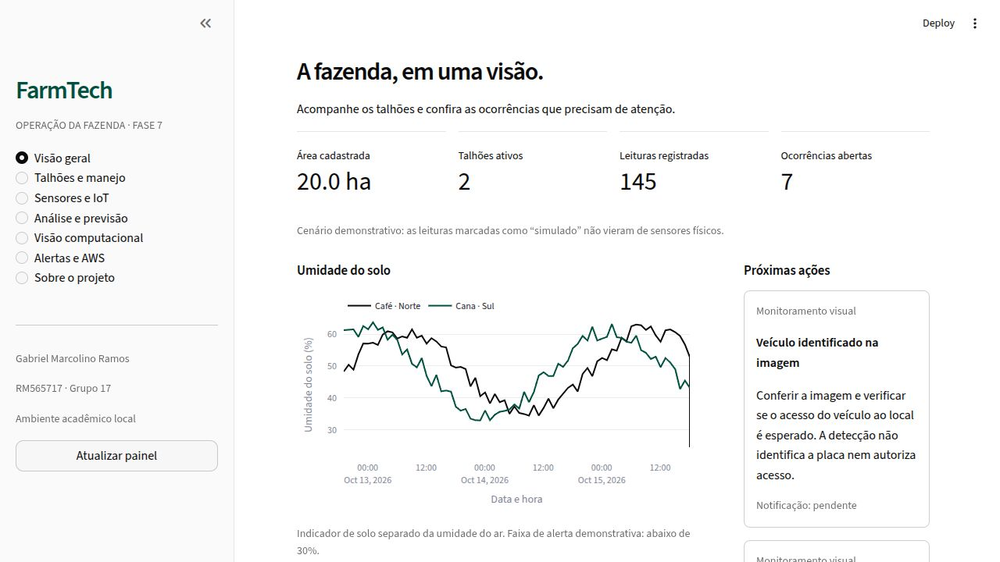

# FarmTech Solutions · Fase 7

**A consolidação de um sistema**

Gabriel Marcolino Ramos · **RM565717** · rm565717@fiap.com.br

Integrante único · Grupo 17 · FIAP Inteligência Artificial

Painel Python que reúne cadastro agrícola, banco relacional, telemetria, análise de rendimento, visão computacional e uma fila de alertas integrada ao Amazon SNS. Os serviços estão na mesma pasta e podem ser acessados pelo Streamlit ou pelo terminal.

**Situação:** aplicação local implementada e em validação. A comprovação de implantação AWS, recebimento de e-mail e vídeo desta fase ainda está pendente. A atividade não foi enviada ao portal. Prazo: **10/11/2026 às 23h59**, America/Sao_Paulo.



## Executar

Pré-requisito: **Python 3.12** e Git. A versão local usa CPU; não precisa de GPU.

```bash
python3.12 -m venv .venv
source .venv/bin/activate
python -m pip install -r requirements-lock.txt
python -m pip install -e .
python scripts/bootstrap_vision.py
python -m farmtech demo
streamlit run app.py --server.port 8507
```

No Windows, ativar com `.venv\Scripts\activate`. Abrir [http://127.0.0.1:8507](http://127.0.0.1:8507). O banco é criado em `runtime/` e os pesos estão em `models/`. O bootstrap obtém somente a revisão oficial fixada do YOLOv5; não treina novamente o detector. O cenário de demonstração contém dados simulados, identificados na interface.

Para uma instalação sem visão computacional, usar `requirements.txt` em vez do lock completo. Para adicionar a visão depois, instalar PyTorch/torchvision CPU pelo índice oficial e `requirements-vision.txt`. Não enviar imagens ou pesos arbitrários para o carregador de modelos: o projeto usa somente seus checkpoints versionados.

```bash
python -m farmtech talhoes
python -m farmtech treinar
python -m farmtech ingerir data/exemplos/leitura.json --talhao 1
python -m farmtech alertas
python -m pytest -q
```

A instalação foi conferida em uma cópia limpa com ambiente Python separado: dependências compatíveis, 18 testes aprovados, métricas reproduzidas e inferência dos 4 modelos executada em CPU. [Registro da reprodução](results/reproducao.json). A validação estática do template AWS passou; isso não comprova implantação.

## Serviços integrados

| Fases | Função no painel | Implementação |
|---|---|---|
| 1 e 2 | Áreas, volumes de insumos, culturas, talhões e meteorologia | `manejo.py`, `clima.py`, `db.py`, `sql/schema.sql` |
| 3 | Histórico, leitura manual, importação atômica e integração ESP32 | `telemetria.py`, `iot/`, `scripts/serial_bridge.py` |
| 4 e 5 | Cinco regressores, 2 baselines, correlações, previsão e perfis climáticos | `analise.py`, `models/produtividade.joblib`, `results/` |
| 6 | YOLOs de 30/60 épocas, padrão, CNN, histórico e ocorrência de veículo | `visao.py`, `models/` |
| 5 e 7 | Regras, fila persistente, ações sugeridas e publicação SNS | `alertas.py`, `infra/alertas.yaml` |

[Origem e adaptações por fase](docs/integracoes.md) · [Requisitos e barema](docs/requisitos.md) · [Dados e licenças](data/README.md) · [Modelo relacional](docs/banco.md).

## Alertas na AWS

A leitura e a ocorrência são gravadas na mesma transação; cada ocorrência tem uma notificação única. Umidade do solo abaixo de 30%, pH fora da faixa demonstrativa e indicadores de nutrientes geram ações para conferência. Uma detecção de carro sugere verificar se o acesso é esperado. Nenhuma regra aciona fisicamente uma bomba ou prescreve insumos.

O publicador usa **SNS Standard com assinatura de e-mail confirmada**. A região e as credenciais temporárias são definidas no ambiente autorizado. [Implantação, segurança e verificação](infra/README.md).

**Evidências AWS pendentes:** criar o tópico na conta autorizada, confirmar a assinatura, enviar uma ocorrência pela aplicação e registrar o e-mail recebido. Os testes locais do publicador usam cliente simulado. Não equivalem a implantação ou entrega de e-mail.

## Resultados e limites

O treinamento usa a base da Fase 5, com 156 registros e 39 cenários. Treino/teste não compartilham cenários; a escolha do modelo usa validação cruzada somente no treino. A tabela completa, baselines e erro por cultura estão em [results/](results/). Yield e precipitação preservam a escala original, com unidades ainda não confirmadas. Um R² agregado alto não substitui o exame do erro por cultura.

DHT22 mede umidade do ar; o LDR representa pH simulado. Hardware físico não foi validado nesta integração. O modelo visual reconhece **gato e carro**, sem diagnosticar pragas ou doenças. As leituras e regras são demonstrativas. A interface distingue fila local, aceitação pelo SNS e comprovação do e-mail.

## Estrutura

```text
app.py          Dashboard de todos os serviços
src/farmtech/   Cálculos, banco, telemetria, ML, visão, alertas e CLI
sql/            Esquema relacional e índices
models/         Checkpoints reproduzíveis
results/        Métricas, previsões e validações reais
scripts/        Treino, bootstrap e ponte serial
iot/            Firmware ESP32 JSON Lines
infra/          Template SNS e procedimento AWS
data/           Base original, imagens licenciadas e exemplo de entrada
assets/         Capturas e saídas reais
docs/           Requisitos, integração, limitações e roteiro
runtime/        Banco operacional local, fora do Git
```

## Vídeo e entrega

Vídeo de até **10 minutos**, com a voz de Gabriel: **a gravar após a validação AWS**. [Roteiro de demonstração](docs/roteiro-video.md). O endereço do YouTube será incluído após publicação como não listado.

O envio final deve ocorrer pelo [portal da FIAP](https://on.fiap.com.br/mod/assign/view.php?id=676739&returnto=conteudocurso), com PDF contendo o link do repositório. Concluir a implantação AWS e o vídeo antes da submissão. Após o envio confirmado, não realizar novos commits.

## Referências e créditos

[Histórico FIAP-IA](https://github.com/gabrielmarcolino23/FIAP-IA) · [Fase 5](https://github.com/FIAP-PROJECTS-GABRIEL-MARCOLINO-RAMOS/farmtech-fase5) · [Fase 6](https://github.com/FIAP-PROJECTS-GABRIEL-MARCOLINO-RAMOS/farmtech-fase6-gabriel-marcolino-ramos) · [YOLOv5 v7.0](https://github.com/ultralytics/yolov5/tree/v7.0) · [Streamlit](https://docs.streamlit.io) · [Open-Meteo](https://open-meteo.com/en/docs) · [Amazon SNS](https://docs.aws.amazon.com/sns/latest/dg/welcome.html).

Código sob GPL-3.0 em razão dos componentes YOLOv5. Fotografias e base tabular têm condições próprias; a licença do código não substitui suas licenças. Consulte [THIRD_PARTY.txt](THIRD_PARTY.txt).
