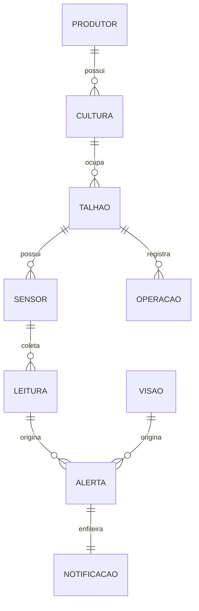

# Banco relacional e ciclo da leitura

SQLite é a persistência local desta demonstração; não é um banco hospedado na AWS. Todas as conexões habilitam chaves estrangeiras, transações e WAL. Consultas parametrizadas evitam interpolação de entrada em SQL.

Cada sensor pertence a um talhão e mantém a origem fixa. `(sensor_id, evento_id)` é único: uma repetição idêntica é ignorada; a mesma identidade com conteúdo diferente rejeita o lote. Todo o lote é validado antes da escrita e a transação é revertida se houver conflito em qualquer linha.

O cadastro permite criar, consultar e atualizar talhões. Arquivar faz a exclusão lógica, preservando leituras e operações. Novas medições para talhão arquivado são rejeitadas. Não são apagados registros referenciados por chaves estrangeiras.

Leitura, regra e notificação são persistidas na mesma transação. O publicador reserva um item com `BEGIN IMMEDIATE`, sem segurar a transação durante a chamada de rede. Estado “aceito_sns” exige MessageId. Erro de rede deixa o item “incerto”; encerramento durante o envio pode deixá-lo “enviando”. Esses casos exigem conferência antes de qualquer retentativa, porque o serviço Standard pode duplicar entregas.

O protótipo escuta somente em `127.0.0.1`. Não há autenticação de múltiplos operadores nem implantação pública do dashboard. Uma implantação compartilhada exige controle de acesso, persistência adequada e gestão de segredos próprios do ambiente.
